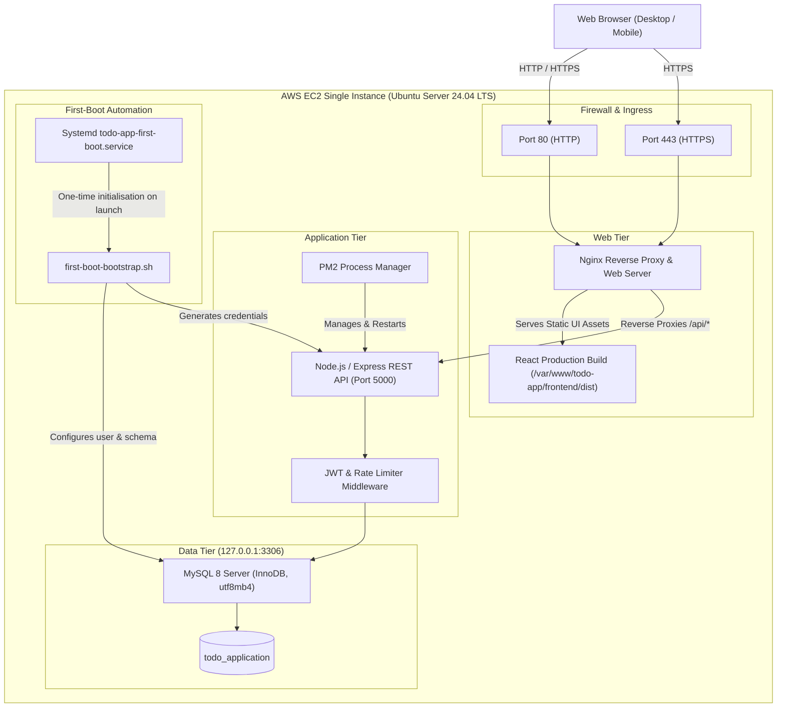

# System Architecture & Technical Specifications

## 1. Overview

The Simple To-Do Application is designed as a secure, high-performance web application optimized for single-instance AWS EC2 deployment and Golden AMI baking. It consists of a React Single-Page Application (SPA) frontend, an Express.js REST API backend, and a locally running MySQL 8.x database managed under systemd and PM2.

---

## 2. Component Architecture

### A. Frontend Tier
- **Framework:** React 18 with Vite build tooling
- **Routing:** React Router v6
- **HTTP Client:** Axios with JWT request interceptors and automatic 401 response handling
- **Styling:** Responsive, custom CSS design system using CSS custom properties with desktop, tablet, and mobile support
- **State Management:** React Context API (`AuthContext`) managing authentication state, token storage, and user profile data

### B. Web Server Tier (Nginx)
- **Role:** High-performance reverse proxy and static content distributor
- **Routing Rules:**
  - `/*` -> Serves React SPA index and assets with client-side route fallback (`try_files $uri $uri/ /index.html`)
  - `/api/*` -> Reverse proxies upstream to Express at `http://127.0.0.1:5000`
- **Performance:** Gzip compression enabled for JS, CSS, JSON, and SVG; 1-year immutable caching for hashed static assets
- **Security:** Standard security headers (`X-Frame-Options`, `X-Content-Type-Options`, `X-XSS-Protection`, `Referrer-Policy`)

### C. Application Backend Tier (Node.js & Express)
- **Runtime:** Node.js 22 LTS managed under PM2 process manager
- **Security Middleware:**
  - `helmet`: Applies Content Security Policy, X-Powered-By removal, and framing protections
  - `express-rate-limit`: General API rate limiting (100 req/15 min) and strict authentication rate limiting (15 req/15 min) to prevent credential stuffing
  - `cookie-parser`: Parses HTTP-only cookies
  - `cors`: Configurable CORS origins with credential support
- **Authentication:** Stateless JWT tokens signed with SHA-256 HMAC and 24-hour expiration; passwords salted and hashed with bcrypt (12 rounds)
- **Data Scoping:** Every task database query strictly scopes by `user_id = req.user.id` to guarantee multi-tenant tenant isolation

### D. Data Tier (MySQL 8 Server)
- **Engine:** InnoDB storage engine with strict foreign key cascading
- **Charset / Collation:** `utf8mb4` with `utf8mb4_unicode_ci` for full Unicode and emoji support
- **Timezone:** UTC (`+00:00`) explicitly configured on connection pool and database engine
- **Network Isolation:** MySQL listens strictly on `127.0.0.1:3306` (external connections denied via `bind-address`)
- **Indexes:**
  - `users(username)`: Unique index for login and registration lookups
  - `tasks(user_id)`: Foreign key index
  - `tasks(user_id, created_at)`: Composite index for historical queries
  - `tasks(user_id, status)`: Composite index for status filtering
  - `tasks(user_id, due_date)`: Composite index for due date ordering and summary aggregates
